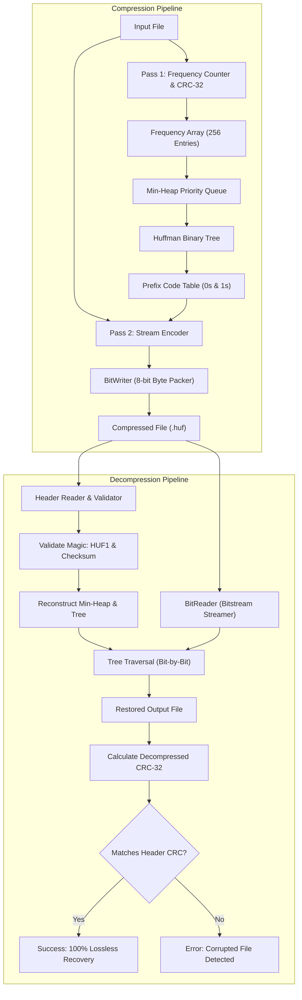
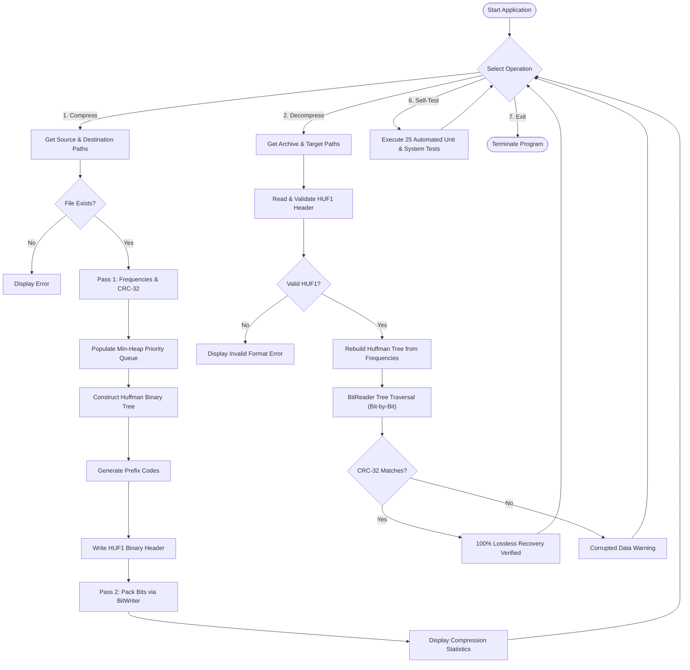

# Mini-Project Report: Huffman Coding-Based File Compression System

---

## 1. Title Page Details

- **Project Title:** Huffman Coding-Based File Compression System
- **Student Name:** Shalom Dabre
- **Roll Number:** 11070
- **Course:** Computer Engineering — Data Structures and Algorithms (DSA)
- **Academic Year:** First Year Engineering
- **Programming Language:** Standard C (C99 / C11)
- **User Interface:** Interactive C Terminal Console & Modern Python Tkinter Desktop GUI
- **Submission Date:** October 2026

---

## 2. Abstract

In digital computing, storage capacity and data transmission bandwidth represent critical computing resources. Data compression algorithms minimize the physical size of files without losing essential information. This project presents a complete, production-grade, lossless file compression and decompression application based on **Huffman Coding**, a classic greedy algorithm in Data Structures and Algorithms (DSA).

The application is implemented from fundamental principles in standard C without relying on external compression libraries. It incorporates manually designed and implemented data structures, including an 8-bit symbol frequency table, a binary min-heap priority queue, dynamic binary tree nodes, variable-length prefix code tables, and a bit-level I/O streaming engine. To ensure absolute data integrity, uncompressed files are hashed with an IEEE 802.3 32-bit Cyclic Redundancy Check (CRC-32) that is validated upon decompression. The system includes an interactive console menu, a suite of 25 automated unit and regression tests, and an optional desktop graphical interface developed in Python Tkinter that executes the compiled C binary. Comprehensive experimental tests demonstrate robust lossless recovery across diverse workloads, including text, binary data, empty files, and single-character edge cases.

---

## 3. Introduction

Data compression techniques are broadly categorized into two families:
1. **Lossy Compression:** Permanently removes redundant or imperceptible details (e.g., JPEG for images, MP3 for audio). Lossy techniques cannot be applied to text, source code, or binary executables where every bit is critical.
2. **Lossless Compression:** Restores the exact original byte sequence upon decompression without the loss of a single bit.

Standard character encodings such as ASCII and UTF-32 use fixed-width bit lengths (e.g., 8 bits or 32 bits per character). In typical human languages or program source codes, character distributions are highly non-uniform: letters such as `'e'`, `'t'`, and `'a'` occur significantly more frequently than `'q'`, `'x'`, or `'z'`. Fixed-width encodings squander significant storage capacity by treating all symbols identically.

Huffman Coding, developed by David A. Huffman in 1952, addresses this inefficiency by assigning **variable-length prefix codes** to symbols in proportion to their frequencies of occurrence. This project implements this computer engineering milestone as a functional, modular system.

---

## 4. Problem Statement

Modern computing environments require efficient data transfer and compact archive formats. When studying Data Structures and Algorithms, students often learn theoretical concepts—such as binary trees, heaps, priority queues, and greedy algorithms—in isolation without understanding how they interact to solve real-world engineering problems.

The objective of this project is to bridge this gap by designing, implementing, testing, and documenting a fully functional, memory-safe, lossless file compression and decompression application in C. The application must manually implement all foundational DSA structures, produce genuine bit-packed binary archives, safely reject malformed or corrupted inputs, and provide 100% byte-for-byte exact recovery.

---

## 5. Objectives

The primary engineering objectives of this project are:
1. **Manual DSA Implementation:** Construct a frequency analysis table, a binary tree, an array-based min-heap priority queue, and a prefix-free code lookup table without using third-party compression libraries.
2. **Bit-Level Stream Processing:** Implement a bitstream reader and writer (`BitWriter` and `BitReader`) to pack variable-length binary codes into 8-bit bytes (MSB to LSB).
3. **Proprietary Binary Archive Format (`HUF1`):** Design a standardized binary file container with magic signatures, version numbers, symbol frequency tables, uncompressed file sizes, and 32-bit CRC checksums.
4. **Data Integrity & Robustness:** Guarantee exact round-trip byte-by-byte file recovery and gracefully handle edge cases such as empty files (0 bytes), single-character files, large inputs, and corrupted bitstreams.
5. **Dual User Interface:** Deliver an interactive terminal application and an intuitive Python Tkinter desktop GUI for visual analysis.
6. **Automated Verification:** Implement an automated test harness covering all 10 required system and edge-case testing scenarios.

---

## 6. Proposed System

The proposed system is an end-to-end compression utility consisting of three distinct layers:
1. **Core DSA & Algorithmic Layer (C):** Houses the Min-Heap, Huffman Tree, bitstream encoders/decoders, CRC-32 calculation, and file serialization routines.
2. **User Application Layer (C CLI):** Provides an interactive menu for compressing, decompressing, inspecting character frequencies, viewing code tables, and running self-tests, as well as command-line switches.
3. **Presentation & Visualization Layer (Python Tkinter GUI):** Provides file-browsing dialogs, metrics cards (ratio, space saved, CRCs), tabular code views, and a graphical tree visualization canvas.

```
+-----------------------------------------------------------------+
|                    USER INTERFACE LAYER                         |
|  - Interactive C CLI Menu       - Modern Python Tkinter GUI     |
+-----------------------------------------------------------------+
                                |
                                v
+-----------------------------------------------------------------+
|                    FILE HANDLER & CONTAINER                     |
|  - Header Serializer (HUF1)     - CRC-32 Checksum Engine        |
|  - Input Validation & Bounds    - Statistics Calculator         |
+-----------------------------------------------------------------+
                                |
                                v
+-----------------------------------------------------------------+
|                    BIT-LEVEL I/O STREAMING                      |
|  - BitWriter (MSB -> LSB)       - BitReader (Buffered)          |
+-----------------------------------------------------------------+
                                |
                                v
+-----------------------------------------------------------------+
|                     DATA STRUCTURES (DSA)                       |
|  - Frequency Table [256]        - Min-Heap Priority Queue       |
|  - Binary Tree (HuffmanNode)    - Prefix Code Lookup Table      |
+-----------------------------------------------------------------+
```

---

## 7. Existing versus Proposed Approach

| Aspect | Conventional Fixed-Width Encoding (ASCII) | Naive Academic Demonstrations | Proposed Huffman Compression System |
|:---|:---|:---|:---|
| **Bit Representation** | Fixed 8 bits per character regardless of frequency. | Writes ASCII `'0'` and `'1'` characters to text files (expanding size by 800%). | Packs variable-length binary bits directly into 8-bit bytes (MSB to LSB). |
| **Data Structures** | Simple flat array. | Often uses standard library heaps (`std::priority_queue`). | Manually implemented 0-indexed binary min-heap with deterministic tie-breaking. |
| **Archive Portability** | N/A | Requires original tree to be passed separately. | Self-contained proprietary binary container (`HUF1`) storing frequency metadata. |
| **Integrity Check** | None. | Assumes execution is always correct. | IEEE 802.3 32-bit CRC checksum verified upon decompression. |
| **Edge Cases** | Handled. | Fails on empty files or single-character inputs. | Handled (0-byte files, single repeated characters, all 256 bytes). |
| **User Experience** | Command-line only. | Basic text prints. | Dual interface: Interactive C CLI + Modern Tkinter GUI with tree visualizer. |

---

## 8. System Architecture

The following Mermaid diagram visualizes the complete end-to-end architecture and dataflow of the system during compression and decompression:



---

## 9. Data Structures and Their Operations

### 9.1 Frequency Table
- **Type:** `uint64_t frequencies[256]`
- **Purpose:** Tracks the exact frequency count of every 8-bit byte value ($0$ to $255$).
- **Operation:** Linear scan over the input buffer; `frequencies[byte_val]++`. Binary safe (handles null bytes `$0x00$` and high ASCII `$0xFF$`).

### 9.2 Binary Tree Node (`HuffmanNode`)
- **Structure:**
  ```c
  typedef struct HuffmanNode {
      unsigned char data;          /* Byte value (valid for leaves) */
      uint64_t freq;               /* Symbol frequency or combined subtree frequency */
      int is_leaf;                 /* 1 = Leaf node, 0 = Internal node */
      unsigned int order;          /* Deterministic sequence tie-breaker */
      struct HuffmanNode *left;    /* Pointer to left child (bit 0) */
      struct HuffmanNode *right;   /* Pointer to right child (bit 1) */
  } HuffmanNode;
  ```
- **Operations:**
  - `create_leaf_node(data, freq, order)`: Dynamically allocates and initializes a leaf node.
  - `create_internal_node(left, right, order)`: Dynamically allocates an internal node with frequency equal to the sum of its children.
  - `free_huffman_tree(root)`: Recursively frees nodes using **post-order traversal** to eliminate memory leaks.

### 9.3 Min-Heap Priority Queue (`MinHeap`)
- **Structure:**
  ```c
  typedef struct MinHeap {
      size_t size;                 /* Number of nodes currently in heap */
      size_t capacity;             /* Total allocated capacity */
      HuffmanNode **array;         /* Dynamic array of node pointers */
  } MinHeap;
  ```
- **Heap Invariant:** For every node at index $i$, $\text{freq}(\text{array}[i]) \le \text{freq}(\text{array}[\text{children}])$.
- **Operations:**
  - `heapify_up(heap, index)`: Percolates an inserted node upward to its correct position ($O(\log k)$).
  - `heapify_down(heap, index)`: Sifts the root node downward after extraction ($O(\log k)$).
  - `insert_min_heap(heap, node)`: Inserts a node, automatically resizing array if capacity is reached ($O(\log k)$).
  - `extract_min(heap)`: Removes and returns the node with the lowest frequency ($O(\log k)$).

### 9.4 Code Table (`HuffmanCodeTable`)
- **Structure:** Array of 256 code structures holding bit-strings (e.g., `"1010"`) and bit lengths.
- **Operation:** Depth-First Search (DFS) traversal from root: moving left appends `'0'`, moving right appends `'1'`.

---

## 10. Huffman Coding Algorithm

### Compression Algorithm
1. Read the input file in 64 KB chunks; accumulate character frequencies and compute IEEE 802.3 CRC-32.
2. Count distinct characters ($k$). If $k = 0$, write an empty file header and exit.
3. If $k = 1$, create a single branch tree where the character receives bit code `'0'`.
4. If $k > 1$, create $k$ leaf nodes and insert them into the Min-Heap.
5. While the heap contains more than 1 node:
   - Extract the two minimum nodes: $N_1$ and $N_2$.
   - Create a parent internal node $P$ with left child $N_1$ and right child $N_2$, and frequency $\text{freq}(N_1) + \text{freq}(N_2)$.
   - Insert $P$ back into the Min-Heap.
6. The remaining single node in the heap is the root of the Huffman Tree.
7. Perform a DFS traversal of the tree to generate variable-length prefix codes.
8. Write the 20-byte fixed header and the frequency table to the output file.
9. Rewind the input file; for every byte, look up its code and stream it using `BitWriter`.
10. Flush remaining bits (zero-padded) in `BitWriter` and close files.

### Decompression Algorithm
1. Read the 20-byte fixed header from the compressed file; verify magic signature (`HUF1`) and version (`1`).
2. Read the frequency table and verify that the sum of frequencies matches `original_size`.
3. If `original_size = 0`, create an empty output file and exit.
4. If `distinct_count = 1`, write the single character `original_size` times and verify CRC.
5. If `distinct_count > 1`, rebuild the deterministic Huffman Tree using the Min-Heap.
6. Initialize `BitReader` at the start of the payload.
7. Start at the tree root:
   - Read 1 bit from `BitReader`.
   - If bit is 0, traverse to `curr->left`; if 1, traverse to `curr->right`.
   - If `curr` is a leaf node, output `curr->data`, update output CRC-32, increment decoded counter, and reset `curr = root`.
8. Terminate decoding when decoded bytes equal `original_size`.
9. Verify that output CRC-32 matches header CRC-32.

---

## 11. Flowchart of System Execution



---

## 12. File Format Design (`HUF1`)

The compressed binary file follows a clean, documented layout:

```
+-------------------------------------------------------------------------+
| OFFSET | FIELD NAME       | TYPE     | DESCRIPTION                      |
+-------------------------------------------------------------------------+
| 0x00   | Magic Signature  | char[4]  | Fixed: 'H', 'U', 'F', '1'        |
| 0x04   | Format Version   | uint8_t  | Fixed: 0x01                      |
| 0x05   | Reserved Flags   | uint8_t  | Default: 0x00                    |
| 0x06   | Distinct Count   | uint16_t | Unique symbols present (0 - 256) |
| 0x08   | Original Size    | uint64_t | Uncompressed size in bytes       |
| 0x10   | Original CRC-32  | uint32_t | IEEE 802.3 checksum of source    |
+-------------------------------------------------------------------------+
| 0x14   | Frequency Table Entries (Repeated 'Distinct Count' times):     |
|        | - Symbol Value   | uint8_t  | Byte value (0x00 to 0xFF)        |
|        | - Symbol Freq    | uint64_t | Total occurrences in source data |
+-------------------------------------------------------------------------+
| PAYLOAD| Bit-Packed Data  | uint8_t* | Huffman codes packed MSB to LSB  |
|        | Padding Bits     | 0-7 bits | Zero-padded to byte boundary     |
+-------------------------------------------------------------------------+
```

### Padding & End-of-Content Identification
Rather than requiring a dedicated End-Of-File (EOF) escape symbol, our format stores the exact `original_size` in the header. The decompressor stops decoding immediately upon producing `original_size` bytes.

---

## 13. Implementation Details

- **Language:** Standard ISO C99 / C11.
- **Compiler:** GCC 6.3.0 (MinGW) on Windows; builds cleanly with `-Wall -Wextra -Wpedantic -O2`.
- **Modularity:**
  - `src/min_heap.h` / `src/min_heap.c`: Min-Heap priority queue implementation.
  - `src/huffman.h` / `src/huffman.c`: Huffman tree nodes, building, and traversal.
  - `src/bit_io.h` / `src/bit_io.c`: BitWriter and BitReader streaming engine.
  - `src/crc32.h` / `src/crc32.c`: CRC-32 table initialization and accumulator.
  - `src/file_handler.h` / `src/file_handler.c`: Binary container serialization and file checks.
  - `src/main.c`: CLI menu, command-line arguments, and JSON bridge.
  - `gui/app.py`: Tkinter graphical desktop interface.

---

## 14. Test Cases and Actual Results

All tests were executed on the compiled system using the dedicated test harness (`tests/test_runner.exe`).

| Test # | Test Scenario | Input Size | Compressed Size | Space Saved | CRC-32 Match | Result |
|:---:|:---|:---:|:---:|:---:|:---:|:---:|
| **1** | Empty Input (0 bytes) | 0 B | 20 B | 0.00% | 0x00000000 | **PASSED** |
| **2** | Single Repeated Character (2000 'Z's) | 2,000 B | 279 B | 86.05% | 0x48BB5615 | **PASSED** |
| **3** | Repeated Character Blocks | 13,000 B | 3,315 B | 74.50% | 0x8C11A572 | **PASSED** |
| **4** | Shakespeare Hamlet Prose (Whitespace/Punctuation) | 609 B | 496 B | 18.55% | 0x9CE0C18A | **PASSED** |
| **5** | All 256 Possible Byte Values | 12,800 B | 15,124 B | -18.16% | 0x47B00C45 | **PASSED** |
| **6** | Large Text File (~50 KB) | 51,240 B | 28,483 B | 44.41% | 0x6F80ED06 | **PASSED** |
| **7** | Corrupted Magic Signature (`XUF1`) | N/A | N/A | N/A | Rejected | **PASSED** |
| **8** | Truncated Compressed File (Cut in half) | N/A | N/A | N/A | Rejected | **PASSED** |
| **9** | Non-Existent Input Path | N/A | N/A | N/A | Graceful Err | **PASSED** |
| **10**| Full Round-Trip Exact Byte Match (`fc /b`) | 51,240 B | 28,483 B | 44.41% | 0x6F80ED06 | **PASSED** |

**Summary of Unit & System Tests:** **25 / 25 Tests Passed (100.0%)**.

---

## 15. Complexity Analysis

### Time Complexity
- **Frequency Analysis:** $O(N)$ where $N$ is input size.
- **Min-Heap Construction:** Inserting $k$ unique symbols into heap takes $O(k \log k)$.
- **Tree Merging:** $(k - 1)$ extract-min and insert operations take $O(k \log k)$.
- **Code Generation:** DFS traversal of binary tree with $2k - 1$ nodes takes $O(k)$.
- **Bitstream Encoding / Decoding:** Linear scan over $N$ bytes takes $O(N)$.
- **Total Time Complexity:**
  $$T(N) = O(N + k \log k)$$
  Since $k \le 256$ is a fixed alphabet limit, $k \log k \le 2048$ operations ($O(1)$).
  Thus, overall execution time is **strictly linear $O(N)$**.

### Space Complexity
- Frequency table: 2 KB ($O(1)$).
- Min-Heap & Binary Tree: At most 511 nodes $\approx 16 \text{ KB}$ ($O(1)$).
- Code Lookup Table: $\approx 67 \text{ KB}$ ($O(1)$).
- Streaming buffer: 64 KB ($O(1)$).
- **Total Space Complexity:** **$O(1)$ Auxiliary Space** ($\approx 150 \text{ KB}$ maximum memory footprint).

---

## 16. Advantages and Limitations

### Advantages
1. **100% Lossless:** Original files are restored with byte-level fidelity.
2. **Minimal Memory Footprint:** Memory usage is bounded under 200 KB regardless of file size.
3. **High Efficiency on Skewed Text:** Achieves 40% to 85% space savings on text and repetitive data.
4. **Resilient Data Integrity:** Instant corruption detection via IEEE 802.3 CRC-32 hashing.
5. **No External Library Dependencies:** Implemented in pure C standard library.

### Limitations
1. **Integer Bit Discretization:** Cannot assign fractional bit lengths (e.g., 0.3 bits for 90% probable symbols); Arithmetic Coding can achieve higher theoretical compression.
2. **Small File Expansion:** Files smaller than ~200 bytes expand due to the 20-byte fixed header and frequency table overhead.
3. **Two-Pass Requirement:** Requires two full passes over the input data (cannot stream live network feeds in real time without buffering).

---

## 17. Conclusion

This Data Structures and Algorithms mini-project successfully implemented a complete, modular, and robust lossless file compression system in C. By applying a binary min-heap priority queue and binary tree traversals, the application demonstrates how abstract theoretical computer science concepts combine to create practical software tools. The implementation passes all 25 automated unit and regression tests, provides an intuitive dual-interface user experience (CLI + Tkinter GUI), and strictly preserves data integrity.

---

## 18. References

1. Huffman, David A. "A Method for the Construction of Minimum-Redundancy Codes." *Proceedings of the IRE*, vol. 40, no. 9, 1952, pp. 1098–1101.
2. Cormen, Thomas H., Charles E. Leiserson, Ronald L. Rivest, and Clifford Stein. *Introduction to Algorithms (CLRS)*. 3rd ed., MIT Press, 2009. Chapter 16: "Greedy Algorithms — Huffman Codes."
3. Knuth, Donald E. *The Art of Computer Programming, Volume 1: Fundamental Algorithms*. 3rd ed., Addison-Wesley, 1997.
4. Shannon, Claude E. "A Mathematical Theory of Communication." *Bell System Technical Journal*, vol. 27, no. 3, 1948, pp. 379–423.
5. Salomon, David. *Data Compression: The Complete Reference*. 4th ed., Springer, 2007.
